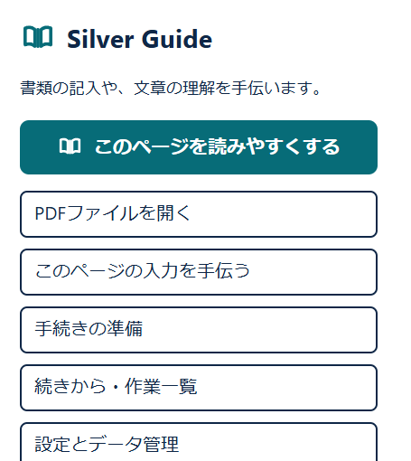
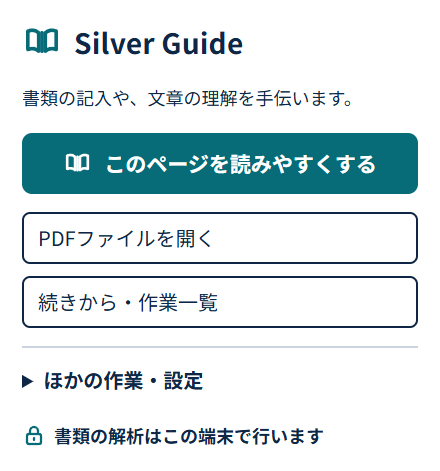
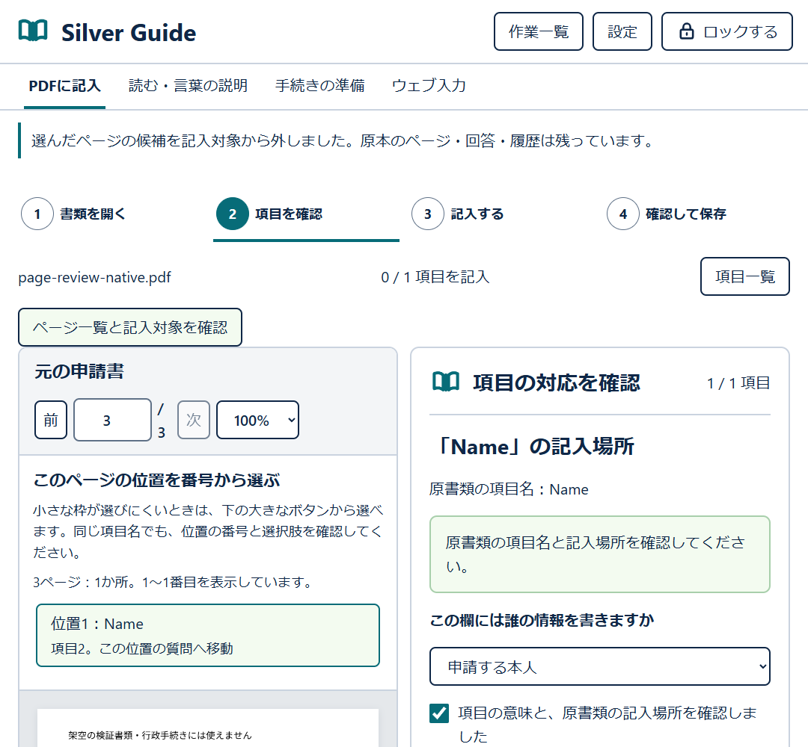
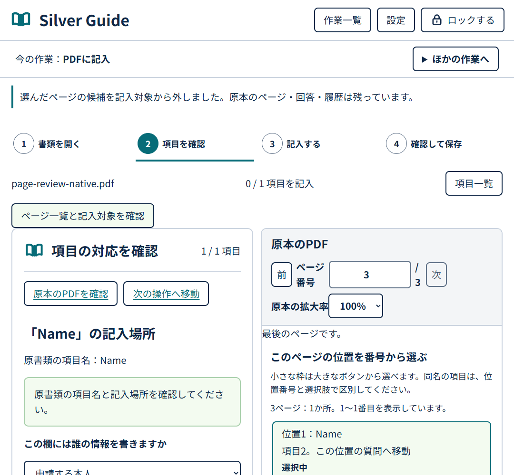
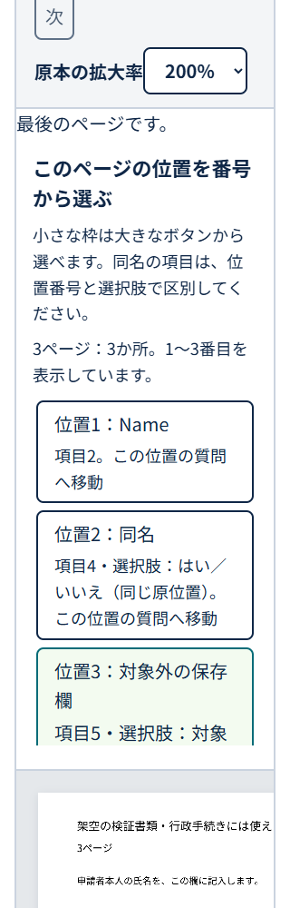

# Silver Guide 2.0 UI 設計

2026-10-14の元ページ支援復元は`c6bfe04e…`の更新です。通常ページの主操作は同じタブに用語の下線と説明・入力欄の案内を表示し、別Readerを任意の補助入口へ移します。ページ内パネルの通常ボタン52px、主操作58px、案内文字18/20/24px、白・青緑・紺と見える焦点を維持します。入力欄との重なりは上下の空きへ移動して避け、案内を一律に畳みません。以下のb96の画像・ボタン数・コントラスト・性能値はその固定版の履歴で、新パネルの測定値ではありません。

本書は最終UI候補 `b96c473355a5a9a81bba5874c0b463a8e7aabec4131d98630b87bfbea807a11f` の実装に合わせた規約です。白地、青緑の主操作、濃紺の文字、本のアイコンを継承し、各工程で次の行動が分かる構成にしています。旧版のポップアップ内設定や左右配置の説明は、本書の構成で置き換えます。

機能と安全境界は [製品設計](product-design.md)、実装の確認状況は [検証記録](verification.md) と [品質評価](quality-evaluation-20261013.md)、操作は [利用者ガイド](user-guide.md) を参照してください。

## 1. 公式資料と製品独自の規約

2026-10-14 JSTに確認した公式参照は、[デジタル庁デザインシステム](https://design.digital.go.jp/dads/)、[ボタン](https://design.digital.go.jp/dads/components/button/)、[ボタンのアクセシビリティ](https://design.digital.go.jp/dads/components/button/accessibility/)、[ウェブアクセシビリティ導入ガイドブック](https://www.digital.go.jp/resources/introduction-to-web-accessibility-guidebook)です。参照版はDADS v2.18.0、ガイドブックは2025-10-16版です。ガイドブックはInformative文書であり、それ自体を適合認定に使いません。

| 区分 | 採用する考え方・基準 |
| --- | --- |
| 公式資料の操作階層 | 主操作は同じ文脈で原則1つ。補助操作の同時提示を抑え、重要度を形と色で区別する。DADSのsecondaryは同じ文脈で原則最大3、tertiaryは原則1で、別文脈の操作と混同しない。 |
| 公式資料の操作・文字 | 44×44 CSS pxの押せる領域、通常文字4.5:1・大きな文字3:1、必要な操作境界3:1を確認項目とする。色だけで状態を伝えず、意味の通る順序、見える焦点、欄名とエラーの関連付けを使う。 |
| 製品独自の寸法 | 専用タブ・ポップアップの通常ボタンは最小高52px、主操作は最小高58px。本文は18/20/24px、基本行高1.6。これらの数値を公式資料の必須値とは説明しない。 |
| 製品独自の工程 | 各工程の主操作を原則1つにし、読込・設定・保存・修正は名前の付いた補助入口へまとめる。未確認や失敗は消して解決扱いにしない。 |

原本PDFの小さい枠は、原本の座標・大きさを保ちます。通常の大きいボタンとは区別し、同じページの番号付き位置一覧から選べる経路を併設します。小さい枠の自動検査指摘と、大きい代替経路の到達証拠は別に記録します。公式の44px方針、製品の52/58px設定、WCAGの達成基準を同一の数値規定として扱いません。

## 2. 色・文字・基本部品

最終候補の[同じ方式による34条件の画面比較](assets/validation-b96c4733-ui-comparison.json)で、アクセシビリティツリーのボタン出現数を602から268へ整理しました。同じ操作が各画面・幅に繰り返し含まれる合計で、操作手順の総数ではありません。開閉項目は追加の入口として別記します。本文20px・行高32px、読書本文20px・行高36px、通常ボタン最小44×52px、主操作最小145×58pxを記録しました。確認できた有効な操作・開閉項目の文字334出現と外側の境界1048辺は最小コントラスト比6.13でした。これは記録したCSS computed色と既知の背景の合成値であり、境界の必要性、焦点の輪郭、本文全域の判定とは別です。PDF画素を背景に持つ6出現は未評価として残し、ページ全体の適合認定とはしません。

| 画面の例 | 前のボタン出現数 | 後のボタン出現数 | 後の開閉入口数 |
| --- | ---: | ---: | ---: |
| 通常ポップアップ | 7 | 3 | 1 |
| PDF用ポップアップ | 7 | 2 | 1 |
| 読み込んだ文章 | 28 | 7 | 3 |
| ウェブ欄の編集 | 10 | 4 | 2 |
| 準備チェックリスト | 11 | 4 | 5 |
| PDFの項目確認 | 32 | 16 | 4 |
| PDFの記入 | 29 | 17 | 4 |
| PDFの出力確認 | 21 | 12 | 3 |
| 設定 | 17 | 6 | 5 |

表は両幅で同じ件数となった代表値です。PDFの後の5状態では、アクセシビリティツリーのファイル入力ボタン各1個が描画command集合と対応せず、その差を未分類で保持しています。閉じた開閉項目の子を誤って数えた旧DOM表示合計は比較に使っていません。旧ネイティブポップアップ幅455から、新440/380への実寸差、HTTP試験元ページのlocalhostから.testへの差も記録しています。後の主操作は標準工程30条件で各1個、作業一覧・設定4条件で0個でした。必要な安全確認は本文に残し、読込・設定・修正・保存の補助入口は操作を探せる名前で示しています。

操作経路も、同時表示数とは別に比較します。次表は当該画面にいて、補助グループが閉じている場合のコントロールの起動・選択回数です。ファイル選択、文字入力、共通の保存ダイアログ、選択部品を操作する個々のキー数は含みません。実画面の操作記録・ARIAと実装の照合による限定比較で、全体のクリック数や所要時間の測定ではありません。

| 操作経路 | 前 → 後 | 設計理由と維持する確認 |
| --- | --- | --- |
| ポップアップからPDFファイルを開く | 1 → 1 | 主入口を直接表示 |
| 別の作業へ切替 | 1 → 2 | 「ほかの作業へ」を開き、名前を読んで選択。今の作業を明示 |
| 読書の元ページ読込・ウェブの元ページ確認 | 1 → 2 | 読込・確認と保存を作業名付きの入口へ集約。貼付文章を開く主操作は直接1回 |
| 読書の非選択箇所を説明・読み上げ | 工具1 → 箇所選択＋共通工具2 | 繰り返していた7箇所×2工具を共通2工具へ。選択済みの箇所は工具1回。対象名と本文抜粋を表示 |
| ウェブ入力の比較・反映 | 確認チェック＋比較＋反映を維持 | 元サイトの保存・送信の確認を省略せず、結果の取消は直接表示 |
| 読書・ウェブ・未完了準備メモの保存 | 1 → 2 | 保存する作業を明示。準備項目の全確認後は直接の主操作1回 |
| 案内から準備開始 | 個別の開始1 → 案内選択＋共通開始2 | 出典と地域を選んでから開始。別の記録を閉じる場合は保持内容を確認 |
| PDF下書き保存 | 1 → 1 | 記入可能・読み取り専用とも直接保存 |
| 記入済みPDFの作成と保存 | 作成＋全ページ確認チェック＋保存を維持 | 記入者・必須性・条件・意味・場所の基本確認を補助グループへ移さない |
| 設定からバックアップ保存 | 1 → 2 | 「下書き・バックアップ・登録情報」を開いて保存。Chromiumの実ファイル内容は認証確認済み、FloorpのSaveAsは未確認 |

補助機能を使うと開閉・箇所選択が増えることを、手順削減と呼びません。頻繁なPDF保存と安全確認を直接残し、補助入口には対象と目的を示す名前を付けました。画面から探す負担、操作時間、記憶負担の改善は未実証で、赤羽台祭での利用者試験に残ります。

変更前の通常ポップアップ。実幅455pxのネイティブ画面で、通常の作業を縦に常時表示していました。

変更後の通常ポップアップ。実幅440pxで主操作1つと補助2つを表示し、残る操作の入口を具体的な名前で示しています。

変更前のPDF項目確認。原本が先にあり、工程途中の操作も常時表示していました。

変更後のPDF項目確認。質問を先に読み、原本と次の操作へ移動できる入口を置きます。必須の指定や条件の確認を省略せず、小さい位置には大きなボタンも用意します。

| 役割 | 値 | 用途 |
| --- | --- | --- |
| 背景 | `#ffffff` | 作業面・ポップアップ・ドック |
| 主文字 | `#0f2747` | 見出し、本文、操作の境界 |
| 主操作 | `#076c78` | 工程ごとの次の行動 |
| 主操作ホバー | `#055b65` | 主操作のポインタ状態 |
| フォーカス | `#0c75a6` | 3pxの輪郭、3pxの外側余白 |
| 区切り | `#cad3df` | セクション、枠 |
| 原文・参照 | `#b5d5ec` | 原文の補助枠 |
| 説明面 | `#a8cfab` / `#f3fbf0` | 説明、ヒント、確認の案内 |
| 成功 | `#176535` | 確認済みの補助表示 |
| 注意・エラー | `#a02222` | 問題の所在と修正案内 |

本のアイコンと文字ラベルを併記し、状態には「選択中」「未確認」「対象外」「保存しています」などの文字を伴わせます。背景、罫線、角丸を機能のまとまりに使い、装飾だけのカードやグラデーションを増やしません。

文字は `Noto Sans JP`, `Yu Gothic UI`, `Meiryo`, `sans-serif` の順に指定し、bodyと入力部品へ継承します。実際に使われる字体は端末によって異なります。PDF書き出し用の同梱日本語フォントは、このUIのフォント指定とは別です。

| 要素 | 実装規約 |
| --- | --- |
| 本文 | ポップアップ18px、専用タブは小18px・中20px・大24px、基本行高1.6 |
| 主操作 | 21px以上・太字・最小高58px、青緑の塗り |
| 通常ボタン・選択部品 | 専用タブは本文サイズを継承、通常ボタンは最小高52px・最小幅44px、濃紺の境界 |
| 開閉の入口 | 内容が分かる文字を付けたsummary、最小高44px |
| チェック・ラジオ | 印そのものだけでなくラベル行を押せる範囲に含める |
| 余白・角丸 | まとまりの間16〜24px、操作8px、説明10px、支援面12pxを基本にする |
| フォーカス | キー操作のボタン・リンク・入力・summaryに輪郭。プログラムで移動する見出しや領域も輪郭を表示 |

無効な主操作の近くには理由と解除方法を置き、必要な箇所では`aria-describedby`で関連付けます。処理中は進行と中止・再試行を伝え、入力が未確認である理由を単に薄い色だけで示しません。

## 3. 入口と共通ナビゲーション

ポップアップの主操作は元のタブの文脈で変わります。PDF URLなら「このPDFに記入する」、通常のページなら「このページを読みやすくする」、元ページを確認できない場合は「文章を開く」です。「PDFファイルを開く」「続きから・作業一覧」を補助入口にし、ウェブ入力、手続き、設定、ページ内支援は「ほかの作業・設定」にまとめます。元ページの確認中や操作中は、その理由を表示します。

ポップアップのCSSは最小幅320px、幅`min(440px, 100vw)`、内側余白22pxです。ネイティブポップアップの自然寸法はブラウザーに依存します。旧版の一律390px以上の説明は使いません。

専用タブでは「今の作業」を文字で示し、「ほかの作業へ」からPDF・読書・手続き・ウェブ入力を切り替えます。「作業一覧」「設定」「ロックする」は共通入口です。切替では新しい内容の見出しへ焦点を移します。元のタブとの関係と、作業の保存先を混同しない構成にします。

## 4. PDFの工程と原本

| 工程 | 主操作 | 常に確認できる内容・補助入口 |
| --- | --- | --- |
| 開く | 元PDFがある場合は「PDFを取得して開く」、ファイルからなら「PDFファイルを開く」 | 取得先と権限、ファイルのドラッグ、「現在のPDF・リンクから開く」 |
| 項目を確認 | 通常は「次の項目へ」、最後は確認済み項目の記入へ | 原項目名、記入者、必須・任意と根拠、条件、意味・場所の確認チェック |
| 記入 | 通常は「次の項目へ」、最後は全体確認へ | 回答、原本、保留、対応の見直し、本人が選ぶ登録情報・表記変換 |
| 確認 | 「記入済みPDFを作成する」 | 未解決項目、出力形式、未記入出力・失われる計算等の機能の確認 |
| 出力を確認 | 「記入済みPDFを保存する」 | 保存されるPDFの全ページ確認、保存状態、「回答を修正する」 |

質問を原本より先にDOMへ置きます。広い画面は質問と原本を左右に並べ、狭い画面は質問、原本の順です。「原本のPDFを確認」「次の操作へ移動」を使って必要な場所へ移れます。原本を隠して入力を進める構成にはしません。

記入者の選択は1か所にまとめ、必須・任意と条件の基本確認を画面内に表示します。開閉だけで確認済みにはなりません。必須性unknownは共通検証でも拒否し、未記入の出力許可や条件不成立で迂回しません。未確認の項目へ戻る場合は対応確認へ案内します。

「項目名・種類・記入場所を修正する」から項目の修正を開き、「原本の欄を追加・修正する」から追加、枠指定、取消・やり直し、再解析を開きます。確認・出力の工程では編集工具を閉じ、「回答を修正する」から戻ります。回答、原本制約、修正履歴を開閉だけで変更しません。

原本には元の枠と、25か所ずつの大きい位置一覧を併設します。位置番号、項目名、選択肢、現在の「選択中」を文字で示します。番号移動はボタンへ焦点を移すだけで、選択・回答変更は行いません。共有する欄、同名の欄、選択肢だけに位置がある欄、対象外を開いて確認する経路も維持します。元の枠を拡大して隣の欄を覆う変更はしません。

ページの入力欄確認・記入欄なし・今回は対象外の3判断は本人の明示操作です。用途のヒントだけで除外しません。除外しても原本・回答・履歴を残し、再び対象にする場合は意味と条件を見直します。複数ページ共有欄は関係する全ページを確認します。

読み取り専用の書類には原本、項目の位置、既存値、文字、再解析、下書き保存を残し、記入・出力の入口を出しません。通常の書類で原本指定により記入できない欄に旧回答が残る場合は、元値と対照し、回答を保持してその欄を記入対象から外せます。

時間切れのページには180秒で最初から読み直す選択を示します。再解析の差分を採用するまで、確認済み項目と回答は保持します。様式案内の変更・失効・撤回も、対象項目だけを原本確認へ戻し、回答や位置を自動置換しません。

*最終UI候補b96c4733の実拡張画面。手動で用意した保存済みの欄・選択肢・対象外の位置を、同じ原本ページの大きいボタンから確認する経路です。自動抽出精度の証拠とは区別します。*

## 5. 読書・ウェブ入力・手続き

- **読書**：「文章の読込と保存」に読込・別文章・保存をまとめます。貼り付け時は表示を開く操作、表示後は読み上げの操作を主にします。「音声と行間の設定」を開いて声・速さ・行間を変更し、「操作する箇所」で対象を選んで説明・読み上げを行えます。本文各所へ同じ操作ボタンを繰り返し置きません。原文・表・リスト・リンクと説明の出典を残します。
- **ウェブ入力**：編集、現在値と比較、反映結果の工程を表示します。「元ページの確認と保存」に読直し・保存をまとめ、比較時は編集領域を隠し、結果時は「入力を見直す」から戻ります。隠した領域の回答は保持します。原サイトが保存・送信する可能性と、条件付き取消の限界を説明します。
- **手続き**：出典と地域を読んで案内を選択し、「選んだ案内で準備を始める」で開始します。チェックリストでは次の未確認・保留項目へ移動し、確認後に保存します。「項目の追加と確認の取消」「準備メモの保存と切替」を補助入口にします。提出・受理は本人の記録で、PDF保存やチェックから自動認定しません。

## 6. 保存・保護・設定

保存は、表示・入力している作業と、まだ作業へ追加していない文字を区別します。読書の貼り付け途中や、手続きの未追加文字を「保存済み」と見せません。これらの編集途中の文字は画面切替で保持し、同じタブでのロックでは一時復旧情報として保護します。別の文章・手続きを開始して今の内容を閉じる操作には、残っている内容と保存対象を説明します。

端末への保存を選んだ作業は変更後に暗号化保存し、切替時にも保存します。保存中・失敗・完了は区別します。設定は文字の大きさと言葉の強調を先に置き、「下書き・バックアップ・登録情報」「案内の更新と出典」「不具合の確認」「通信と権限」を開いて操作します。登録情報の選択だけで元サイトやPDFへ転記しません。

保護中は画面の操作を一時停止します。プライベートウィンドウ、または保護状態を確認できない場合は通常の保管庫や更新の保存を止め、理由と再確認の入口を示します。PDF・読書の端末内処理と、元サイトへの反映や取得権限は別の処理として説明します。

## 7. 焦点・拡大・検証の範囲

キー操作で開閉・選択・工程移動できるHTML要素を使い、変更後の見出し、原本、位置番号の移動先にも焦点の輪郭を表示します。非表示の工程・閉じた補助領域へ利用者の焦点を残さず、入力欄のラベル、エラーの場所、修正方法を関連付けます。動きを減らす設定と強制色では、文字・境界・現在状態を使って内容を伝えます。ページ内ドックはShadow DOMで元サイトのCSSと分離し、移動・縮小・閉じる操作と画面内への位置調整を持ちます。

このUI候補の574テスト、型検査、両ブラウザー向けビルドは確認済みです。[保存済み候補の最終UI検証](assets/validation-b96c4733-small-targets.json)では、実Chromium拡張の公開バックアップ取込と作業一覧から再開し、CFA原本2ページの保存済み625候補を全件操作しました。

| 確認対象 | 実操作の範囲 |
| --- | --- |
| 保存済み625候補 | 320/1080 CSS px × 原本PDF拡大率75/100/200%の6条件で3,750回の大きいボタン選択。大きいボタンと原本枠をそれぞれ625回、焦点を置いてEnterで選択 |
| 手動で用意した境界資料 | 36状態・84回のポインタ操作、14回ずつの大きいボタン・原本枠のキー選択。共有、同名、選択肢だけの位置、対象外の再閲覧を確認 |
| 原本と保存内容 | 認証した前後バックアップ10作業で原本、フィールド、回答、回答状態、ページ判断、修正・表記履歴が一致。選択中の項目と工程位置は比較対象から除外 |
| 実寸・実行資材 | 大きいボタンの最小幅240px・最小高84.796875px。ソースと両ビルド計646ファイルは不変。既知の出生情報付き所有processは終了後alive0・unknown0 |

この625件は以前に保存した候補で、今回の新しい検出結果や、原本上の真の記入欄625件を意味しません。原本の小さい枠にはaxeの`target-size`指摘625件が残り、手動の境界資料のaxe指摘は0でした。大きい代替経路の全件対応・到達証拠を、小さい枠の指摘0や完全なWCAG適合へ読み替えません。全件キー操作は焦点を置いてEnterで行い、ページ操作からのTab経路は別に確認しています。625枠すべての小さいポインタ領域を直接クリックしたという検証ではありません。

この6条件の200%は原本PDFの表示倍率です。[最終Floorpの確認](assets/validation-b96c4733-floorp-http.json)では、読書画面を実ブラウザーfull-page zoom 200%でも検証し、幅519 CSS pxで横はみ出し0、入力欄の右端503・選択欄の右端483を確認しました。これは文字だけの拡大やズーム400%の確認とは別です。Floorpで320を要求した際の実幅は458で、320合格とはしていません。記録した17画面・34条件のbefore/after画像と操作経路の比較は完了し、本書に反映しました。[最終UIの正式性能測定](assets/validation-b96c4733-performance-final.json)もChromium・Floorp各60、合計120新規profileで完了し、11指標×2の全22集計でp95とその片側95%上限が既定予算内、失敗・打切り0件でした。物理8コア・61.66GiBの開発機と固定資料での結果です。UI変更前との因果的な速度改善や、記憶負担の軽減を実証したものではありません。基準機の認定と標本メモリー値の限界は[検証記録](verification.md)へ分けて記載します。旧版の測定結果をこの版の合格へ繰り越しません。自動検査やソース確認を、NVDAによる確認、実利用者試験、完全なWCAG適合認定へ置き換えません。赤羽台祭での将来の実利用者試験と配布運用は [試験計画](akabanedai-test-plan.md) を参照してください。

## 実装参照

[共通トークン](../src/shared/tokens.css)、[ポップアップ](../src/popup/ProductPopup.tsx)、[ポップアップCSS](../src/popup/popup.css)、[専用タブ](../src/apps/workspace/WorkspaceApp.tsx)、[作業画面CSS](../src/apps/workspace/workspace.css)、[PDF画面](../src/apps/workspace/PdfWorkspace.tsx)、[PDF確認工具](../src/apps/workspace/PdfFieldTools.tsx)、[原本と位置一覧](../src/apps/workspace/PdfPreview.tsx) を対応する実装とします。
