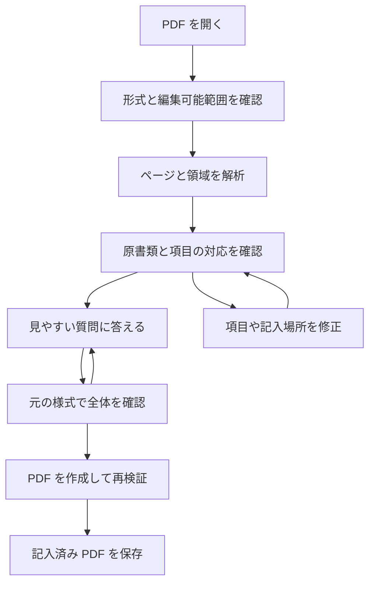
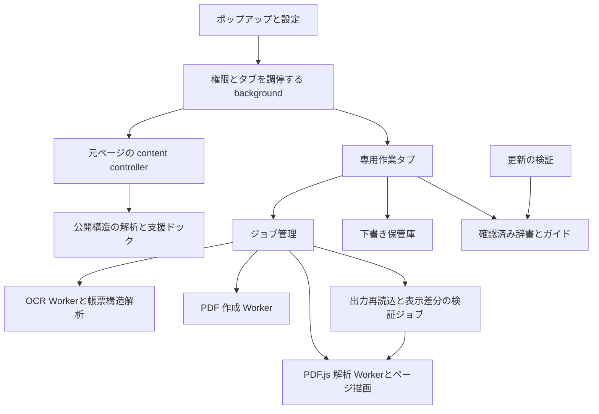

# Silver Guide 製品設計

> 2026-10-14 PDF入力導線の改訂：標準画面は左に単一の入力欄・短い説明・戻る／次へ、右に原本を常時表示する。読み取り後すぐに入力でき、最終項目の「PDFを保存」で検証と保存を連続実行する。推定した記入者・必須性・ページ判断を確認済みに書き換えない。編集専用の inputMode=direct で意味確認の必須工程を省き、回答型・原本の不変制約・記入位置・文字数・出力再検証は維持する。下書き・補正はメニューから利用し、従来の詳細編集は任意の経路として残す。下記の従来確認工程は標準入力の必須手順ではない。


設計基準日 2026年10月12日。対象は Silver Guide の次期製品版。現行 0.1 の実装とは区別する。

Silver Guide は、行政を中心としたウェブページや申請書を理解し、必要な情報を記入し、本人が確認して手続きを進めるためのブラウザー拡張機能である。PDF を読みやすい質問形式に変換し、回答を元の様式へ反映する機能を製品の中心に置く。用語説明、読書表示、読み上げ、手続きのチェックリスト、下書きの再開を同じ作業画面から利用できるようにする。

白地、青緑の主操作、大きな文字、広い余白という既存の視覚設計を継承する。操作の構成は見直し、長い作業をポップアップや元ページの寿命に依存させない。

本設計は MVP の仕様ではない。以下の標準機能、汎用 PDF の解析と修正、保存と復旧、品質基準、配布と保守を製品公開の条件に含める。実装順序は依存関係を表し、途中段階を製品完成として扱わない。

## 1 製品の目的と利用者

主な利用者は、行政用語、複雑な入力画面、小さい文字、紙の様式を再現した PDF に負担を感じる人である。高齢者の利用を優先して設計するが、年齢を利用条件にしない。家族や支援者が同じ端末で操作を手伝う場面も扱う。

成功は「説明を表示できた」ではなく、必要な情報を理解でき、記入済みの書類を作れ、次に本人が行うことを把握できたかで評価する。PDF の保存、ウェブフォームへの入力反映、申請の提出、受理はそれぞれ別の状態である。

製品の原則は次のとおりとする。

- 原文と元書類をいつでも確認できる。説明や質問が原文の条件、数字、否定、例外を隠さない。
- 自動解析の結果と、確認済みの様式情報と、本人の修正を区別する。
- 記入場所、回答、書き出される結果を本人が確認できる。
- 標準の解析と記入は端末内で完結し、アカウントや外部 AI サービスを必須にしない。
- 戻る、取消、後回し、途中保存、再開を主要操作として扱う。
- 制度の利用資格、法的な適否、本人確認の成否を推測して確定しない。

## 2 対応範囲と設計上の決定

| 対象 | 製品として提供すること | 境界 |
| --- | --- | --- |
| 通常の PDF フォーム | 入力欄の抽出、質問化、元の入力欄への反映 | 内部の欄名だけで意味を決定しない |
| 入力欄のない文字 PDF | 文字、罫線、配置から項目を抽出し、元様式へ重ねて記入 | 推定した欄を確認・修正できる |
| スキャン PDF と混在 PDF | 領域単位の OCR と配置解析、質問化、元様式への記入 | 読めない箇所や手書き部分を確認対象にする |
| 任意の通常ウェブページ | 選択語句の説明、本文の整理、読みやすい表示、読み上げ | 説明の根拠がない内容は確定説明を作らない |
| ウェブフォーム | 項目の整理、記入例、形式補助、エラー案内、確認付き入力反映 | 対応する入力部品とサイト条件を限定して明示する |
| 確認済み行政手続き | 必要書類、順番、公式導線、提出後の確認事項 | 地域、様式の版、出典、確認日を持つ |
| 作業保存 | 暗号化した下書き、再開、削除、暗号化バックアップ | 自動クラウド同期やアカウント復旧を前提にしない |

暗号化 PDF、署名済み PDF、XFA、破損文書などは一括して「PDF 対応」と表示しない。詳細な能力判定を [PDF 処理仕様](specs/pdf-pipeline.md) に定める。任意の PDF に自動処理の完全成功を約束せず、対応形式では確認と手動修正によって完成できる経路を持つ。

主要環境は Windows 上の Floorp とする。Firefox は互換性検証対象とし、macOS と Linux の Floorp は第二の検証対象とする。Chromium と Edge は同じドメインモデルを利用する別の配布物として扱う。各環境の正式なサポート版は、署名済み配布物による実機試験で確定し、サポート表に記録する。現行 manifest の最小 Firefox 121 を無条件には継承しない。

標準版に外部の生成 AI による解析を含めない。将来の外部解析は別の任意機能として、送信対象の確認、送信先、保持期間、費用、取り消せる同意を持つ。標準版の品質不足を、未契約の外部サービスへ依存して補わない。

## 3 公開時に必要な機能

以下の ID は品質試験との対応に使用する。全項目を製品公開の対象とする。

| ID | 機能 | 完了の基準 |
| --- | --- | --- |
| SG01 | PDF の取り込み | ファイル選択、ドラッグ投入、取得可能な PDF リンク、現在の PDF から同じ作業へ入れる |
| SG02 | PDF の能力判定 | 編集可能、読み取りのみ、要確認、非対応を理由付きで示す |
| SG03 | 汎用帳票解析 | 入力欄、文字 PDF、画像 PDF、混在ページを解析し、根拠と位置を保持する |
| SG04 | 項目対応の確認と修正 | 項目の追加、削除、順序、ラベル、枠、選択肢を修正できる |
| SG05 | 見やすい記入画面 | 小さなまとまりで質問し、記入例、形式、原文、原本の位置を示す |
| SG06 | PDF への反映と保存 | 日本語、日付、チェック、表、複数ページを正しい位置へ反映し、出力を再検証する |
| SG07 | 文章と用語の説明 | 語句・文を選択でき、文脈に合う確認済み説明と原文を対照できる |
| SG08 | 読書表示と読み上げ | 見出し、リスト、表、注記を保ち、文字調整と音声の制御を提供する |
| SG09 | 手続きの案内 | 出典のある準備、記入、提出、控え、結果確認をチェックリストにする |
| SG10 | ウェブ入力支援 | 対象フォームを区別し、対応する欄だけ確認付きで反映する |
| SG11 | 下書きと復旧 | 選択した作業を暗号化保存し、再起動や更新後に再開できる |
| SG12 | アクセシビリティ | 全画面と項目修正をキーボードとスクリーンリーダーで利用できる |
| SG13 | 中断と障害への対応 | 解析の取消、部分成功、再試行、容量不足、復旧を扱う |
| SG14 | 継続運用 | 様式と説明の更新、改版検知、署名配布、ロールバック、問い合わせを提供する |

## 4 画面と操作の構成

ポップアップは開始と再開の入口にする。現在の対象に応じて「このPDFに記入する」または「このページを読みやすくする」を主操作として示す。通常ページの主操作は元ページ上の支援を開始し、別タブを開かない。元ページのIDとURLを固定して状態・開始・停止を照合し、移動済みのページや失効した対象へは実行しない。「続きから・作業一覧」と、必要な場合の「PDFファイルを開く」を補助操作にし、別Readerは「文章を別タブで開く」という任意の入口にする。専用タブでは現在の作業を表示し、「ほかの作業へ」から切り替える。各工程の主操作を原則1つとし、基本的な確認・戻る・取消は名前の明確な経路に残す。

通常ページの読解と入力欄の確認は元ページ上で行い、PDFの記入・作業の保管庫・希望した別Readerには拡張機能の専用タブを使う。タブには現在の作業名、処理状態、保存状態、元書類へ戻る操作、次に行う主操作を置く。小さいポップアップを閉じても入力や解析は失われない。Firefox 内蔵 PDF ビューアには content script を注入できないため、その DOM の操作を PDF 支援の前提にしない。[Mozilla の content script 制約](https://developer.mozilla.org/en-US/docs/Mozilla/Add-ons/WebExtensions/Content_scripts)

最終UIの配置・操作入口・公式資料への対応・実測した変更前後の操作数は[UI設計](design-system.md)を適用する。PDFは質問の後に原本を置き、必須・任意・記入者・条件の基本確認を折り畳まない。小さい原本枠は大きな番号付き位置一覧でも選べる。読書・ウェブ・手続きは作業を保持したまま切り替え、未追加の入力も画面保護後の再開で保持する。URL取得はサイトの許可待ちと取得中を区別し、中止による復帰と遅れた応答の無効化を保証する。実装・実測の限界と未達品質は[品質評価](quality-evaluation-20261013.md)へ明記し、実利用者試験や公開・署名・保守体制の決定とは区別する。

| 画面 | 主な情報 | 主操作と復帰経路 |
| --- | --- | --- |
| 作業一覧 | 一時作業、下書き、書き出した作業 | 新規、再開、複製、削除 |
| PDF 取り込み | ファイル、ページ数、取得元、能力判定 | 読み取りを始める、別のファイルを開く |
| 解析中 | 現在のページ、処理段階、完了ページ | 中止、失敗ページを再試行 |
| 項目の確認 | 質問一覧と原書類、要確認の理由 | 確認、修正、追加、記入へ進む |
| 記入 | 質問、説明、記入例、回答、原書類の該当箇所 | 戻る、次へ、あとで入力、保存 |
| 全体の確認 | 記入済み原様式、未記入、配置の問題 | 該当項目へ戻る、書き出す |
| 書き出し結果 | 作成と検証の結果、保存の成否 | 保存、保存した PDF を表示、修正へ戻る |
| 読書と説明 | 原文、説明、出典、見出し、音声位置 | 原文へ、再生、停止、段落移動 |
| 手続き | 準備、公式導線、提出方法、確認事項 | チェック、取消、出典を開く |
| 下書きと設定 | 保存方式、保護、文字、音声、データ管理 | 解除、バックアップ、削除 |

ページ内ドックは折りたたみと移動ができる。位置は非機密の表示設定として保存し、画面外へ出た場合は戻す。プライベートな文脈では通常の位置設定を読み書きしない。通常は最大55vh、狭い画面では48vhのスクロールするパネルとし、元の入力欄が重なる場合は上下の空きへ高さを調整して移す。案内の本文を一律に畳まず、パネル操作へ焦点が入った際に位置を戻してクリックを落とさない。長い説明もページ内で読め、別タブは本人が選ぶ補助経路にする。

### 4.1 PDF の基本操作



質問は「本人の情報」「連絡先」「申請内容」などのまとまりで進める。原文の項目名を隠さず、その下に短い説明を置く。質問の選択と原書類の位置を双方向に連携させる。別の人の氏名欄や複数ページの同名欄を同じ質問として混同しない。

「未記入」「あとで入力」「該当しない」「記入済み」「形式を確認」を区別する。任意項目のスキップと、必須項目の欠落は別の状態にする。必須の根拠が不明な欄を必須と決めない。空欄のまま保存する場合は、本人が未完了を認識できる表示にする。

進捗は質問への回答と本人の確認に基づく。「8項目中5項目を記入、2項目は確認が必要」のように示す。単に欄へフォーカスしたことを記入完了にしない。PDF 保存後には提出方法を案内できるが、「申請完了」と表示しない。

### 4.2 項目修正の操作

自動解析だけで終わらせず、原 PDF の拡大表示から記入枠を指定できる。位置調整はドラッグに加え、キーボード移動、寸法の入力、既存の枠候補の選択を提供する。読み上げ利用者にはページ番号、原文ラベル、候補の順番、位置の説明を示す。画像だけで意味を確認できない欄は未解決として残し、助けを求めるための案内を用意する。

未解決のページ、領域、質問、理由を一覧にし、「同じ端末で一緒に確認する」画面から支援者が原本と候補を照合できる。本人の操作権限を自動で他者へ渡さず、確認後は元の質問へ戻る。外部への書類送信をこの操作の前提にしない。解決できない場合は保留して再開でき、未解決を記入完了へ数えない。

修正を取り消せる履歴を持つ。解析をやり直しても本人の修正を無断で上書きしない。再解析結果は差分として提示し、採用する変更を選べるようにする。

## 5 用語説明と読みやすい表示

元ページの支援開始は旧版同様、辞書にある用語への下線を既定とし、表示設定で外せる。本文の語句を自分で選ぶ説明も維持する。リンク・ボタン・ラベル・編集領域や非表示部分は加工しない。停止時は自作の包みとスタイルだけを外し、元のTextノードまたはサイトの後編集を保持する。別Readerの控えめな強調表示は別の設定として扱う。一般的な語義の説明を制度固有の対象・条件・期限の確定へ読み替えない。

説明の優先順は、対象サイト・手続きに対応する確認済み説明、地域と文脈に合う辞書、一般的な辞書とする。候補が複数ある場合は選択肢を示す。「通知」「決定」などを常に行政の意味へ置き換えない。辞書には表記、読み、意味、利用文脈、例、出典、確認日、改版履歴を持たせる。

文章の説明は、原文にある結論、条件、必要な行動を整理し、確認済みの用語説明を添える。返却結果は結論、条件、行動、注意点、用語の各要素と、それぞれの原文範囲を持つ。各要素を選ぶと対応する原文へ移れる。複雑な条件は省略せず原文を引用し、理解できない関係を「条件は確認が必要」と示す。

標準の処理は、見出しと文の分割、行政文書の言い回しのパターン、出典付き用語、文脈別の確認済み説明を組み合わせる。未知の制度の説明を自由生成して確定情報として出さない。対応できない語句も選択可能とし、原文と関連する公式資料へ戻れるようにする。説明できた、部分的に整理できた、原文のみの三状態を持ち、原文へ戻すだけを説明成功に数えない。文章整理のルールは数字、日付、否定、例外を保存する検証を通す。

読書表示は元サイトとは別の表示で、見出し移動、文字サイズ、行間、行長、原文対照を提供する。表、リスト、リンク、脚注の関係を保ち、抽出漏れのある部分を示す。申請フォームや本人確認の操作を読書表示で置き換えない。

読み上げは再生、一時停止、停止、速度、声、段落移動、現在位置を持つ。自動再生しない。標準版は端末の日本語音声を利用し、利用可能な音声がない場合は OS の音声追加手順を示す。`SpeechSynthesisVoice.localService` は音声サービスがローカルかどうかを表すため、声を列挙して確認し、リモート音声へ黙って切り替えない。[音声サービスの判定](https://developer.mozilla.org/en-US/docs/Web/API/SpeechSynthesisVoice/localService)

## 6 手続きの案内とウェブフォーム

### 6.1 手続きのチェックリスト

手続き情報は、地域、対象ページ、様式の版、出典、確認日、有効期間、担当する保守者の役割を持つ。準備するもの、費用、期限、記入、提出方法、控え、結果確認を別の手順として管理する。日時や条件を算出する場合は参照した規則と基準日を表示する。日本の手続きの日時は Asia/Tokyo を基本とする。

本人が手順を完了として記録し、いつでも戻せる。リンクを開いた、PDF を保存した、チェックを付けたという操作だけで受理を推定しない。制度の対象条件は原文と説明を示す。給付対象かどうか等の判定を製品が確定しない。

確認済みガイドがない場合も、利用者が自分で作る準備メモとチェックリストを利用できる。これは公式情報と区別する。文書とページをまたぐ作業を一つの作業 ID に関連付けるが、別の様式への回答の再利用には確認を必要とする。

### 6.2 ウェブ入力の支援

フォームは `form`、見出し、ラベル、入力のグループ、必要な属性から範囲を決める。検索欄と申請欄、ラジオの各選択肢と一つの質問、非表示と無効の欄を区別する。必須、形式、記入例、ページが示すエラーを整理して表示する。

初期状態では入力値を読む必要のない説明を提供する。「この欄を確認」「入力欄に反映する」の操作時に、その対象の値だけを扱う。共通の氏名・住所を端末のプロフィールへ登録する機能は提供するが、保存は本人が選び、暗号化下書きと同じ保護を使う。個人番号、パスワード、認証コード、決済情報は共通プロフィールと自動反映の対象にしない。

反映前に対象サイト、対象項目、現在の内容、反映後の内容を対照表示する。反映対象を選び、本人が「このサイトの入力欄に反映する」を実行する。フォームの送信、決済、ログイン、本人確認、ファイル選択、同意チェックの自動実行は行わない。

汎用アダプターは検証済みの標準 HTML 入力部品を対象とする。独自の UI、制御された入力、日付部品、フレーム内の入力は、契約試験を通したサイト別アダプターだけが反映を行う。反映直前に URL、文書、項目の指紋、現在値を再検証し、変化があればやり直す。変更イベントにサイトの自動保存が連動する場合があるため、サイトへの反映を「外部通信がない」と説明しない。

取消は、反映後に本人やサイトが変更した欄を上書きしない条件付きの取消とする。元の値と反映した値を比較し、現在値が反映した値に一致するときだけ戻す。失敗した欄は成功とまとめず、手入力を支援する。反映前には「このサイトが入力を保存する場合があります」、取消時には「入力欄を戻しても、サイトへ送信済みの内容は取り消せません」と示す。取消の変更イベントもサイトの保存を起動し得るため、サイトの処理全体のロールバックとは扱わない。

## 7 継承するデザインとアクセシビリティ

配色と基本部品は [既存デザイン規約](design-system.md) を継承する。規約中の旧ポップアップ構成、設定数、旧ドック位置は本設計の画面構成へ置き換える。

| 役割 | 継承する値 |
| --- | --- |
| 背景と主文字 | `#ffffff` と `#0f2747` |
| 主操作とホバー | `#076c78` と `#055b65` |
| フォーカス | `#0c75a6` の 3px 輪郭 |
| 区切り | `#cad3df` |
| 説明 | `#f3fbf0` の背景と `#a8cfab` の枠 |
| 原文の参照 | `#b5d5ec` |
| 本文と行間 | 初期 20px、最小 18px、行間 1.6 以上 |
| 主操作と副操作 | 主操作 21px 以上で高さ 58px 以上、副操作高さ 52px 以上 |
| 角丸と余白 | 操作 8px、枠 10px、支援面 12px、8px 単位の余白 |

色の継承はコントラスト試験を免除しない。各組み合わせを測定し、装飾用の淡い罫線を必須の入力境界として単独使用しない。操作の意味、選択状態、問題を色だけで伝えない。

WCAG 2.2 AA を拡張機能の画面に対する品質基準とし、原サイト全体の適合を主張しない。200% の文字拡大、400% ズームでのリフロー、フォーカスの遮蔽、状態通知、入力エラー、ドラッグ以外の操作を検証する。PDF 原本の図面部分は二次元表示を保ち、質問と操作部分はリフローする。[WCAG 2.2](https://www.w3.org/TR/WCAG22/)

全体の読み順と見出し構造を持ち、重要な進行変化は読み上げへ通知する。進捗率の毎回の更新を読み上げて妨げない。ツールチップやダイアログを閉じた後は、起点へフォーカスを戻す。新しいエラーには項目名、理由、修正方法を置く。

## 8 技術構成

React と React Aria Components を表示層に用いる。ドメインモデルは UI から独立させ、PDF 解析、回答、確認、書き出し、保存を明示的な状態遷移で扱う。現在の巨大な `content.ts` に PDF 機能を追加しない。



| 構成要素 | 責務 | 保持するデータ |
| --- | --- | --- |
| background | 権限、タブ、メッセージ送信元、サイト支援の調停 | 値を含まない短命の状態 |
| content controller | 元ページの対象欄、説明、許可された反映、停止処理 | 明示対象の値を必要な期間だけ |
| 作業タブ | 作業状態、質問、原本対照、本人の確認 | 一時作業の平文データ |
| PDF.js と OCR Worker | PDFの解析、文字・描画命令の取得、文字認識 | 処理中のページと文書 |
| 出力 Worker | 元 bytes からPDFを作成、字形・配置・原本制約の検査 | 一回の出力ジョブ |
| 検証ジョブ | 新しいPDF.js文書の再読込、値・ページ構造・ラスタ差分の検査、検証済み出力の登録 | 検証中の出力と1ページ分の描画 |
| 下書き保管庫 | 暗号化、保存、復旧、削除、移行 | 暗号文と最小限の管理情報 |
| ガイド管理 | 確認済みの説明と様式、署名検証、版の管理 | 個人情報を含まないデータ |

長いジョブの正本を background のメモリーに置かない。作業タブの終了時に一時作業は終了し、暗号化保存を選んだ作業は最後の保存地点から再開する。解除中の保管庫を共有する作業画面は一つの所有セッションにまとめ、二重書き込みを防ぐ。

実装時の実行分担は[PDFの実行分担の採用記録](decisions/pdf-execution.md)に固定する。検証全体を一つの専用Workerへ移す初期案から変更し、PDF.jsの独立文書と作業タブの検証ジョブを用いる。作業タブにはnative再読込と画素比較も残るため、すべての処理が別スレッドで動くと説明しない。取消・世代管理・資源上限と応答性の品質基準は維持する。

PDF.js、Tesseract.js、pdf-lib を主要な評価候補とする。PDF の欄の意味の判断は、文字、位置、罫線、ラベル、入力型、確認済み様式を組み合わせる構造解析層の責務である。OCR だけで意味を確定しない。モデルを採用する場合も、端末内で実行する補助器とし、未検証のモデル出力を直接書き出し位置へ適用しない。

ライブラリ、Worker、WASM、日本語認識データ、CMap、フォントは同梱する。実行時の CDN 依存やリモートコード読込を使わない。依存バージョンは固定し、仕様書の API と採用する版の挙動を契約試験で照合する。WASM の許可は実行先ごとに狭く設定する。[WebExtension の CSP](https://developer.mozilla.org/en-US/docs/Mozilla/Add-ons/WebExtensions/manifest.json/content_security_policy)

詳細は [PDF 処理仕様](specs/pdf-pipeline.md)、[データと状態の契約](specs/data-contracts.md) に定める。

実装の配置は次を基準にする。エンジンごとの API は adapters に閉じ込め、画面と domain が特定の PDF ライブラリへ直接依存しない。

```text
src/
  apps/          popup、workspace、settings、共通画面
  domain/        document、field、answer、task、guide、explanation
  background/    permissions、tabs、sender 検証、配布物更新の調停
  content/       controller、page analysis、dock、form adapters
  workers/       OCR、PDF作成。PDF.jsの同梱Workerも使用
  adapters/      WebExtension、PDF.js、Tesseract、pdf-lib、speech
  vault/         crypto、IDB、revision、backup、migration
  guides/        glossary、procedures、templates、update verifier
  shared/        schemas、messages、design tokens、UI components
tests/
  corpus/        正解と固定された書類
  contracts/     エンジンとサイト部品の契約試験
  integration/   PDF、保管庫、状態と復旧
  e2e/           実際の拡張配布物の操作
  accessibility/ キーボードと読み上げの確認資材
```

## 9 入力情報と下書きの管理

既存仕様の「入力値を一切取得しない」は、次期版では「明示された作業のためにだけ入力を扱い、保存と外部移動を本人が選ぶ」に置き換える。

| データ | 通常の扱い | 保存を選んだ場合 |
| --- | --- | --- |
| 原 PDF、抽出文字、画像、項目対応、回答 | 作業タブと Worker のメモリー | 保管庫へ暗号化保存 |
| プロフィールと個人メモ | 未登録が初期状態 | 保管庫へ暗号化保存 |
| 手続きの進捗、本文、読書位置、ページ URL | 一時作業 | 機密性を考慮して保管庫へ保存 |
| 文字、ドック位置、音声の選択 | 非機密設定 | `storage.local` |
| 辞書、テンプレート、ガイド、検証資材 | 拡張に同梱 | 個人情報とは別の公開データ領域 |
| 診断 | ローカルのエラーコードと処理時間 | 送信は対象をプレビューした本人の操作時のみ |

下書き保存は初期状態で無効にする。「この作業を端末に保存する」を選ぶと保管庫を作り、保護用のパスフレーズを設定する。暗号化方式、鍵の導出、ロック、更新、バックアップ、削除はデータ契約で定める。保護用の鍵を暗号文と同じ場所へ平文保存しない。

自動保存は解除中かつ保存を選んだ作業だけに行う。入力から 1 秒の待機後に保存し、最大 5 秒以内のコミットを目標とする。保存完了は実際のコミット後に表示する。容量不足や失敗は表示し、平文保存へ切り替えない。一時作業を閉じる際は残すか破棄するかを選べるが、保存しない選択を繰り返し妨げない。

鍵は所有セッションのメモリーに限り、ブラウザー再起動、明示ロック、最後の作業タブ終了、初期 10 分の操作停止で解除状態を終える。自動ロックの 60秒前に読み上げ可能な通知と延長操作を出す。ロックは編集受付停止、最新の保存対象の暗号化とコミット、結果確定、平文 UI と鍵、Worker、音声、Blob URL、キャッシュの破棄の順に行う。

保存失敗や端末保存を選んでいない作業は、解除中の保管庫の鍵で暗号化した一時復旧情報をメモリーに残し、平文を保持せずロックできるようにする。この情報はディスクへ自動保存せず、同じタブを閉じると失われることを表示する。保管庫を作っていない一時作業に保管庫の自動ロックを適用して復旧可能と表示しない。解除後は保存地点と利用可能な一時復旧情報から再構築する。JavaScript のメモリー消去や端末侵害に対する完全な秘匿は保証しない。

保護用パスフレーズを忘れた場合、運営者による復旧はできない。保管庫を初期化する前に既存の暗号化バックアップを残せるようにする。端末移行は本人が保存した暗号化バックアップを使い、自動同期を行わない。OS が保管するダウンロード済み PDF、印刷物、バックアップは拡張内データの削除対象と区別する。

画面の文言は「この端末で解析します」「下書きをこの端末に保存します」「このサイトの入力欄に反映します」を使い分ける。全処理に固定で「入力内容は送信しません」と表示しない。

## 10 権限と文書の境界

基本権限は `activeTab`、`scripting`、`storage` とする。PDF の保存には `downloads` を使用し、その目的を説明する。`<all_urls>` を常時必須にせず、PDF 取得とサイトの継続支援に必要なホスト権限を本人の操作時に求める。拒否した場合もファイル選択と一時的なページ支援を利用できる。

URL 取得は HTTP と HTTPS に限る。background は権限を調停し、作業タブが fetch、AbortController、サイズ監視、原本 bytes の所有を担う。原本を制御 IPC で background から中継しない。リダイレクトを自動で無条件に追わず、移動先の権限と出所を確認する。移動先を安全に取得できない場合はファイル選択へ案内する。ブラウザーが持つログイン状態を利用できる場合でも、認証情報を拡張の保存や独自ログへ移さない。ページ内 Blob、期限付きリンク、取得制限がある PDF は、サイト自身から保存したファイルを選ぶ経路を用意する。

元ページ、PDF、OCR 文字列、ガイド更新は信頼済みコードとして扱わない。DOM と説明は安全なテキスト表示を使い、PDF の JavaScript、起動アクション、埋め込みファイルを実行しない。外部リソースへ自動アクセスせず、出力時に能動的なアクションを除去する検証を通す。詳細な出力契約は PDF 仕様を参照する。

メッセージは種別、送信元、タブ、フレーム、作業 ID、文書 revision、データ型、サイズを検証する。ページから任意の URL 取得、任意タブ操作、保管庫の読み取りを要求できる窓口を作らない。

Mozilla の配布条件では、2025年11月3日以降の新規拡張は組み込みのデータ収集同意への対応が必要である。製品 manifest は実際の通信と一致する分類を設定する。本文と回答の送信がないことだけで、更新取得や診断を含む全通信を無条件に `none` と宣言しない。新規配布か既存公開物の更新か、対応ブラウザー版と合わせて公開前に確認する。[Firefox のデータ収集同意](https://extensionworkshop.com/documentation/develop/firefox-builtin-data-consent/)

## 11 辞書と様式の更新

テンプレートは項目名、記入位置、形式、説明、出典、文書識別条件からなるデータとする。任意 JavaScript、自由な式評価、外部 URL 実行を含めない。条件は型のある制限された述語で表し、深さ、数、計算時間を制限する。

元 PDF の完全一致には bytes のハッシュを使う。近い様式にはページ構造と文字の指紋を使うが、改版や罫線移動を検出したら完全一致と区別し、対応確認を要求する。作業は採用したテンプレートの版を固定し、更新で回答の位置を黙って変更しない。

同梱ガイドで通信なしに動作する。追加のデータ更新は専用の公開配信元から取得し、HTTPS に加えて同梱公開鍵による署名、版、適用範囲、サイズ、スキーマを検証する。検証後にまとめて切り替え、既知の撤回対象を除く最後に動作した版へ戻せる。適用中の版と最高到達リリース番号、撤回情報は分けて持ち、復旧で後者を後退させない。配信元には原書類のハッシュ、ファイル名、閲覧 URL、回答を送らない。配信サービスの IP 等のアクセス情報の扱いもプライバシー説明に含める。

制度や様式の管理役は、改版情報、利用者の訂正報告、リンク切れを確認し、別の確認者のレビューを経て公開する。期限切れや撤回されたガイドは詳細支援を停止し、本人が持つ元資料と説明へ戻れるようにする。新しい説明を既存の記入済み作業へ自動適用しない。

## 12 障害と復旧

各ジョブは受付、解析、要確認、記入、出力、検証、保存を区別する。取消と失敗は別の状態であり、部分成功と最後の保存地点を残す。文書 revision が変わったら古い解析・出力結果を採用しない。

| 問題 | 利用者に示すこと | 復旧 |
| --- | --- | --- |
| PDF 取得不可 | 取得元と失敗理由 | ファイル選択、必要な権限の再確認 |
| 一部ページの解析失敗 | ページと未解決領域 | 該当ページの再試行、手動修正 |
| OCR が不鮮明 | 読めなかった原箇所 | 拡大して確認、入力場所を本人が指定 |
| Worker 停止 | 完了した範囲と中断 | 保存した地点からジョブを再作成 |
| 保存容量不足 | 保存できていないこと | 不要下書き削除、暗号化バックアップ、一時作業継続 |
| PDF 出力の配置不一致 | 問題のページと項目 | 回答や枠の修正、再出力 |
| ダウンロード失敗 | PDF 検証は完了しているか、保存は失敗したか | ファイル保存の再試行 |
| サイト改版 | 変わった欄と詳細支援の停止 | 再確認、一般説明、手入力 |

再試行で回答や本人の修正を初期化しない。解析と書き出しの速度や上限、エラーコードと復旧処理は補足仕様に定める。

## 13 品質基準と公開条件

採用する OCR、構造解析、PDF ライブラリは実際の日本語書類で評価する。スコアをそのまま正解確率と表示せず、独立した検証資料で校正する。テンプレート一致と自動推定の評価を混ぜない。

公開条件は [品質と配布仕様](specs/quality-and-release.md) に定める。数値は設計目標であり、達成済みの性能ではない。日本語出力、回転ページ、混在ページ、チェック欄、文字のはみ出し、保存復旧、任意 PDF の項目修正、キーボード操作を必須の検証に含める。

通常の解析速度に加え、低速端末で UI が操作できること、取消できること、100ページを一度に画像化しないことを検証する。解析精度が基準を満たさない場合、危険な推定を隠して公開するのではなく、自動確定の範囲と要確認表示を修正して再評価する。

製品は署名済み配布物で試験する。配布 ID、更新経路、プライバシー説明、ライセンスとフォントの再配布条件、依存資産一覧、問い合わせ先、データ削除方法を公開前に確定する。製品バージョンの更新で下書きが読めなくなる場合は、移行または読み取り用の互換経路を用意する。

## 14 現行資産の再利用と実装順序

| 現行資産 | 次期版での扱い |
| --- | --- |
| 配色、余白、文字、フォーカス、React Aria 部品 | 共通トークンと部品として継承 |
| WebExtension API のアダプター | ブラウザー差異を閉じ込める層へ発展 |
| 明示開始と停止、Shadow DOM | ページ支援のライフサイクルとして継承 |
| 20語の辞書 | 出典と文脈を付けて辞書の一部に移行 |
| 空の GuidePack | 新しいガイド契約で作成し、実在する手続きを検証 |
| 文字サイズと原文表示の設定 | 新しい設定へ一度だけ移行 |
| 単一の content.ts と簡易状態 | 分割し、値、説明、保存、解析を別の責務へ移す |
| 旧仕様の入力値禁止と固定プライバシー文言 | 本設計の値の利用範囲と処理別文言へ置き換える |

実装順序は以下とする。すべて完了してから製品公開を判断する。

1. データ契約、ジョブ管理、共通 UI、保管庫、資材の固定、ブラウザー能力判定を実装する。
2. 入力欄、文字 PDF、画像と混在 PDF、汎用の構造解析を同じ欄モデルへ接続する。
3. 項目修正、質問入力、原本対照、日本語出力、出力の再検証を完成させる。
4. 辞書と文章整理、読書と音声、手続き、確認付きウェブ反映を接続する。
5. 様式の保守、署名データ更新、移行と復旧、アクセシビリティ、性能、配布試験を完了する。

開発の着手前に、ブラウザー最低版、ライブラリと日本語資材の固定版、検証書類の利用権、配布 ID、公開ガイドの保守担当を決定する。これらは設計範囲の未定ではなく、実装と公開の判定に使う採用記録である。根拠のない期限、精度、配布主体を決め打ちしない。

## 15 補足仕様

- [PDF 処理仕様](specs/pdf-pipeline.md) は解析、座標、信頼度、出力、例外形式の契約を定める。
- [データと状態の契約](specs/data-contracts.md) はモデル、状態、保存、メッセージ、移行の契約を定める。
- [品質と配布仕様](specs/quality-and-release.md) は要件に対応する試験、精度、性能、配布、運用の条件を定める。

現行 0.1 の設計と確認記録は履歴として残す。本設計と補足仕様を次期版の正本とし、同じ事項で旧要件と異なる場合は本設計を適用する。既存デザインの色と基本寸法は継承する。
