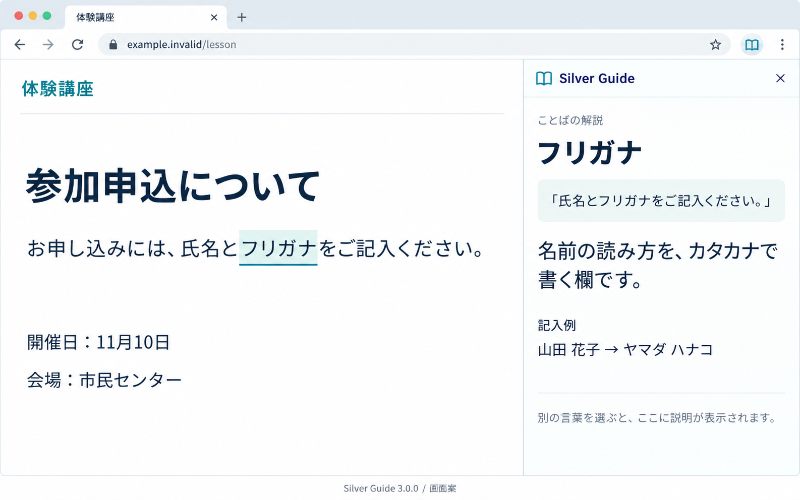
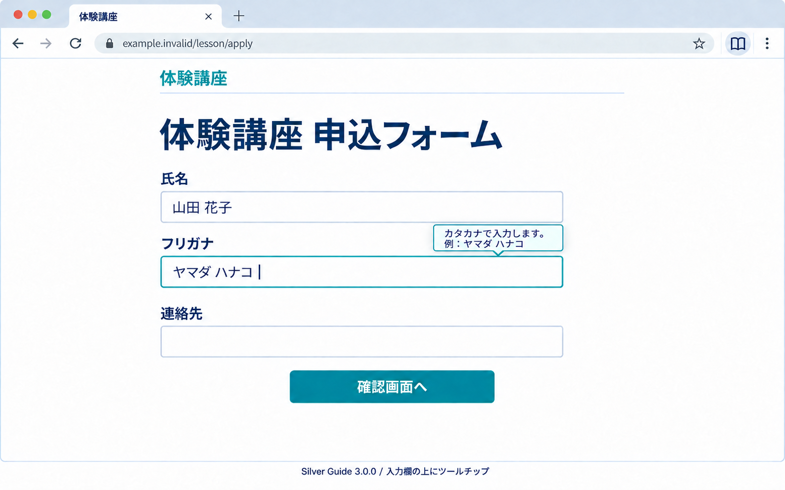
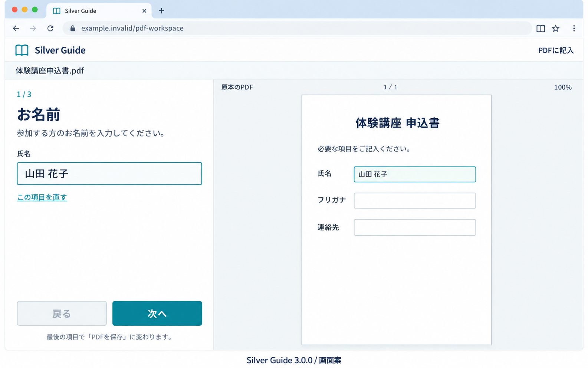

# Silver Guide 3.0.0 画面構成と操作の流れ

確定日：2026-10-20 JST。状態：**フォーム＝上側 Tooltip、単語解説＝下線クリックでページ内ポップアップ、PDF＝専用タブを採用済み**。文章の範囲選択によるサイドパネル解説は補助として残す。[Spec](spec.md) に従う画面仕様。寸法・文言・ブラウザー枠の見た目は実装で調整する。以下の画像はモック。単語ポップアップの今回の改訂は本文を正とし、既存のサイドパネル画像で代用しない。実装と実機の確認結果は [実装状況](implementation-status.md) に記録する。

提供機能は PDF・フォーム入力・解説の三つ。独自のパスワード、保管庫、下書き管理、履歴、登録情報、バックアップ、別 Reader、読み上げ、手続きチェックリストは追加しない。

## 1. 採用した配置

| 機能 | 表示する場所 | 配置の理由 |
| --- | --- | --- |
| 単語の解説 | 下線の単語の近くに出るページ内ポップアップ | 下線を押すだけで、その場で短い説明を読める |
| 文章の解説（補助） | ブラウザーのサイドパネル | 長い範囲を選ぶときに、原文と説明を並べて読める |
| フォーム入力 | 元サイトのフォーカスした欄の上に付く小さな Tooltip | 横の余白に依存せず、入力場所やページのレイアウトを変えずにヒントを読める |
| PDF | 専用タブの左に質問、右に記入プレビュー | 入力した回答と記入位置をPDF上で確認でき、狭いパネルへ PDF 全体を押し込まない |

単語解説とフォーム補助は、サイドパネルを開かず元のページで使える。拡張アイコンを押すと、文章範囲を選ぶための解説サイドパネルを直接開く。間に機能選択用の拡張ポップアップを挟まない。三機能の切替タブ、ダッシュボード、設定メニューを常設しない。

画像ではサイドパネルを右側に描くが、左右・幅はブラウザーの設定に従う。右固定や厳密な幅を動作保証にはしない。約400〜440 CSS pxを最初の設計目安とし、狭い幅でも一列で使えるようにする。

## 2. 入口：フォームと解説を分ける

フォームは、ブラウザーでアクセスが許可された対象ページの欄へフォーカスすると補助が出る。サイドパネルを開いたり、そこで入力を開始したりすることを要求しない。

単語解説は本文の下線を押して使う。文章を範囲選択する補助経路では、拡張アイコンからサイドパネルを直接開く。パネル上部に Silver Guide と現在の対象ページ名を表示する。ページ別の入口・表示は次のとおり。

| 今のページ | まず表示するもの | 操作 |
| --- | --- | --- |
| 通常の文章ページ | 同梱辞書に対応する本文語の下線 | 下線の単語をクリック。短いページ内ポップアップを読む。長文は補助のサイドパネルで範囲選択する |
| 入力フォームのあるページ | 欄にフォーカスすると、その欄の近くへ短い補助 | 元サイトの欄へ直接入力する。パネル内の開始ボタンや別入力欄は作らない |
| PDF を表示しているページ | 「PDFを開く」 | 専用タブでファイルを選ぶ。表示中 PDF の自動取得は現在の対応範囲に含めない |
| 直接支援できないページ | 「このページでは文章や入力欄を読み取れません」 | その理由を表示し、「PDFを開く」を利用可能な入口として残す |

通常ページの解説パネルでは「PDFを開く」を控えめな補助入口として残す。フォームの補助に、作業と関係のない入口を並べない。

フォーム補助は許可済みの対象ページで自動追従する。未許可時はブラウザー標準の権限操作を用い、欄ごとの起動や許可を要求しない。自動注入・許可拒否・動的遷移・制限ページの扱いは、[実装計画](implementation-plan.md) の工程1で確認する。現在の2.0の起動処理を、そのまま要件の実現済みとして扱わない。

## 3. 解説：下線を押す → その場で読む

1. 許可済みページの本文にある、下線の付いた難しい単語をクリックする。
2. 単語の近くへ一つのポップアップを出し、「元の言葉」「短い説明」「閉じる」だけを表示する。サイドパネルや別画面を開く工程はない。
3. 閉じる、Escape、外側のクリックで畳む。別の下線語を押すと同じ一つのポップアップへ説明を切り替える。
4. キーボードではTabで下線語へ移動し、Enter／Spaceで開く。元のページの入力・リンク・ボタンを妨げない。

本文の文字を変えず、辞書に説明のある語だけを下線で示す。元サイトのリンク・ボタン・フォーム欄とラベル・編集領域・コードへは追加しない。フォーム内の公開本文や、後から追加・変更された本文でも下線を更新する。元のレイアウトを押し動かさず、画面端でも読める位置と幅へ収める。

**単語ポップアップの操作ボタンは「閉じる」一つ。** 開始・次へ・元へ戻る・設定・サイドパネルへ移すボタンを並べない。フォームのTooltipには閉じるボタンを追加しない。

### 長い文章はサイドパネルで読む（補助）

拡張アイコンからサイドパネルを開き、元ページの語句や文章を範囲選択する。パネルに原文・説明・必要な例や出典を表示し、選び直すと更新する。「解説する」は毎回押させず、パネルを閉じるときはブラウザー枠の操作を使う。

ポインタでは選択確定時、キーボードでは選択が落ち着いた時点で更新する。入力欄・パスワード欄・編集領域の内容を、文章選択として勝手に解説へ送らない。対応する説明がない場合はその旨を示す。空の結果を成功扱いしたり、設定画面へ誘導したりしない。

## 4. フォーム：欄にフォーカス → Tooltip を読む → 直接入力

1. 元サイトの欄をクリックするか、Tab キーでフォーカスする。
2. その欄のすぐ上へ小さな Tooltip を表示する。フリガナ欄なら「カタカナで入力します。」「例：ヤマダ ハナコ」の二行程度。下向きの先端で対象の欄を示す。
3. 元の欄へ直接入力する。補助へフォーカスを移したり、もう一つの入力欄へ同じ値を入れたりしない。
4. 次の欄へフォーカスを移すと、補助も次の欄の内容へ切り替わる。Shift+Tab でも同じように戻れる。
5. 欄から離れるか Escape を押すと補助を畳む。最後の確認・送信は元サイトの操作をそのまま使う。

**拡張独自のフォーム操作ボタンは原則ゼロ。** 「入力を手伝う」「戻る」「次へ」「フォームに反映」「補助を閉じる」のボタン、進捗表示、別入力用パネルを増やさない。元サイトのボタンと送信の流れは変えない。

補助は入力欄に紐付く非モーダルな Tooltip とする。欄の横幅いっぱいのバナーや常設の説明枠は置かず、元フォームを押し下げない。細い枠・控えめな影・小さな吹き出しの先端で対象との関係を示す。説明と例の短い本文だけを載せ、ロゴ・見出し・操作ボタン・閉じる X を入れない。

説明は一、二行と例一つに絞る。元サイトに同じ説明やエラーが出ている場合はそちらを優先し、重複する説明を増やさない。用途や入力形式が不明な欄には、推測したヒントを断定表示しない。

**基本位置は入力欄の上。左右には出さない。** 欄の上端と Tooltip の先端を8〜12 CSS px程度離し、吹き出し本体は可能な限り欄の横幅の内側へ収める。幅は欄と画面の幅に合わせて制限し、ページの横にはみ出させない。

画面上端に収まらない、前の項目や現在のラベルを隠す場合に限り、下側へ切り替える。入力欄・既存エラー・IME 候補を避け、上下とも場所がない場合は追加案内を無理に表示しない。フォームを押し下げたり、左右への移動や自動縮小を繰り返したりせず、元の入力操作を優先する。

補助は Tab 順へ独自の停止点を増やさず、キー入力・文字選択・コピー＆ペーストを奪わない。Escape で閉じた直後に同じ欄で再表示せず、次のフォーカスまで閉じた状態を保つ。元サイトの Escape 操作がある場合も妨げない。

表示はクリックとキーボードフォーカスの両方に対応し、hover だけに依存しない。入力中に時間で自動消去しない。Tooltip 本体へフォーカスを移さず、欄からフォーカスが離れた場合や Escape で閉じる。支援技術へ説明を関連付ける場合は `role="tooltip"` と `aria-describedby` を参考にし、元サイトの既存の説明との関連付けを上書きしない。[WAI の Tooltip パターン案](https://www.w3.org/WAI/ARIA/apg/patterns/tooltip/)は検討中の資料として参照する。

長い文章を詳しく読みたい場合は、文章解説のサイドパネルを使う。通常の欄補助にその起動ボタンを必須で追加しない。自動入力、フリガナへの自動変換、値の上書き、自動送信は行わない。

前の [フォーム用サイドパネル画像](assets/form-sidepanel.png)、[欄の下の説明枠画像](assets/form-focus-hint.png)、[右側の Tooltip 画像](assets/form-tooltip.png) は非採用の検討履歴。現在の採用構成を示すのは、入力欄の上に出す Tooltip の画像である。

## 5. PDF：開く → 一項目ずつ記入 → PDF を保存

1. 「PDFを開く」からファイルを選ぶ。ファイルを落とす操作も同じ結果へつなげ、同等の取得ボタンを横並びにしない。
2. 専用タブで原本を読み取る。処理中に必要な操作は「中止」だけ。
3. 左は現在位置・項目名・短い説明・入力欄、右は記入プレビュー。入力が落ち着くと自動で仮想書き込みし、選んだ質問の欄へ追従する。変換中のIMEは確定を待つ。通常画面に更新ボタンを増やさない。
4. 左下に「戻る」、右下に「次へ」。最後だけ右下が「PDFを保存」に変わる。位置は動かさない。
5. 作成と出力の検査を連続実行し、実際の保存結果を示す。検査を利用者が個別に実行するボタンは置かない。

PDF 専用タブではサイドパネルへ同じ質問を重複表示しない。画像はサイドパネルを閉じた状態で原本の表示領域を確保したもの。タブを移った際のネイティブパネルの扱いはブラウザー別に確認する。

「この項目を直す」は必要時だけ使う補助入口。修正画面では今の項目だけを対象にし、「変更を適用」「変更を取り消す」の二つで元の質問へ戻る。項目名・記入位置など選んだ内容だけを直し、種類・座標・条件の全工具を一度に並べない。

最後の保存が失敗しても、入力は保持する。原因を直せる場合は「該当する項目へ戻る」、一時的な失敗なら「もう一度保存する」のどちらかを主操作にする。

## 6. 共通の見た目

- 既存の白地・青緑の主操作・濃い文字・淡いミントの説明を引き継ぐ。
- 基本文字は20 CSS px程度、見出しは24〜28 CSS px、操作領域は48 CSS px以上を初期目安にする。見た目と実機の拡大・キー操作を合わせて調整する。
- 色の強い主ボタンは各状態一つ。説明だけの状態はゼロでもよい。
- PDF の下部の進む・戻るは位置を保つ。フォーム補助は元欄にフォーカスを保ち、入力欄や画面内のエラーを隠さない。
- 本のアイコン以外も、主要操作は文字で分かるようにする。三機能のタブ列、設定の歯車、ステップの切替ボタンは足さない。
- 小さなリンクも操作の一つとして数える。ボタンをリンクへ変えただけで簡素化したとは扱わない。

## 7. 入力場所と一時状態を増やさない設計

以下は実装案で、モックが動作の実証を示すものではない。

- フォームの値は元サイトの入力欄に置く。拡張は別の回答コピー・反映待ちの下書きを作らず、保存・復元のためだけに値を取得しない。
- Content は今フォーカスしている欄と、その公開ラベル・説明・形式だけを使って案内する。欄の削除・非表示・無効化・ページ切替で案内を終了する。
- フォーカス移動に合わせて案内を消す際も、入力欄・元サイトのクリック先・Tab 順序を変えない。旧版の大きいドックや前後移動ボタンはそのまま継承しない。
- 解説の結果は `windowId / tabId / 元ページの文書世代` に結び付け、別タブや別ウィンドウの結果を混ぜない。古い応答で現在の案内を上書きしない。
- 単語ポップアップやパネルを閉じても、元フォームの入力値は変えない。PDF 入力は開いている PDF 作業タブが保持する。通常とプライベートの状態も混ぜない。
- 元タブや PDF 作業タブの再読み込み・終了、ブラウザー終了後の復元は保証しない。永続下書き・履歴・パスワードへ拡張しない。

最初の実機確認では、欄へのフォーカス追従、元サイトのイベントと値の保持、Tab・Escape・IME・拡大・動的な欄変更を優先する。

## 8. ブラウザー対応の確認

Firefox 側には `sidebar_action` と `sidebarAction`、Chromium 側には `side_panel` と `sidePanel` がある。ユーザー操作でパネルを開く規則に合わせ、拡張アイコンの押下ですぐ開き、内容の準備をパネル内で行う。[Firefox open](https://developer.mozilla.org/en-US/docs/Mozilla/Add-ons/WebExtensions/API/sidebarAction/open)、[Chrome sidePanel](https://developer.chrome.com/docs/extensions/reference/api/sidePanel)

Firefox のサイドバーは元ページを操作しても表示を保つが、閉じるとサイドバー文書は破棄される。フォーム入力をパネルに移さず元の欄に残すことで、この開閉に回答の寿命を結び付けない。[MDN Sidebars](https://developer.mozilla.org/en-US/docs/Mozilla/Add-ons/WebExtensions/user_interface/Sidebars)

現在の `action.default_popup` を入口として使う設計は見直す。Firefox 側では popup を指定していると `action.onClicked` が発生しないため、直接起動する経路と両立する manifest を用意する。[MDN action.onClicked](https://developer.mozilla.org/en-US/docs/Mozilla/Add-ons/WebExtensions/API/action/onClicked)

API 差は内部で吸収し、利用者に方式を選ばせない。Floorpの実機での結果、正式対応と未実施項目は [実装状況](implementation-status.md) にまとめる。

## 9. この画面構成の確認課題

1. サイドパネルを開かず、本文の下線語をクリックして短いポップアップを読む。閉じる・Escape・外側クリックを試し、別の語へ切り替える。Tab・Enter／Spaceでも使える。
2. 元フォームの氏名・フリガナ・連絡先に、クリックと Tab の両方で直接入力する。補助が今の欄に追従し、欄やエラー、IME 候補を隠さない。
3. 補助を Escape で畳む。解説パネルを開閉しても元欄の値は変わらず、フォーム入力にパネル操作を要求されない。
4. PDF に三項目を入力し、最後の同じ場所のボタンから日本語 PDF を保存する。
5. 説明を読み直す、欄を修正する、保存が失敗する場合も、最初からの入力や管理画面へ戻されない。
6. 補助経路としてアイコンからサイドパネルを開き、文章を範囲選択して説明を読む。元リンク・ボタン・フォーム欄とラベル・編集領域・コードは、下線やポップアップの対象にせず通常どおり使える。

画像生成のための資料は [最初の三画面のプロンプト](assets/mockup-prompts.md)、[説明枠の改訂プロンプト](assets/form-focus-hint-prompt.md)、[右側 Tooltip の改訂プロンプト](assets/form-tooltip-prompt.md)、[上側 Tooltip の改訂プロンプト](assets/form-tooltip-above-prompt.md) に保存する。画像は架空の案内・フォーム・PDF を用いた完成イメージであり、既存版の実画面ではない。
